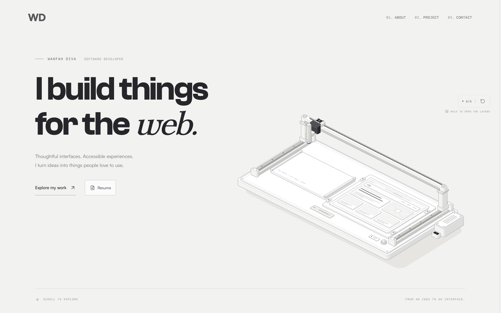
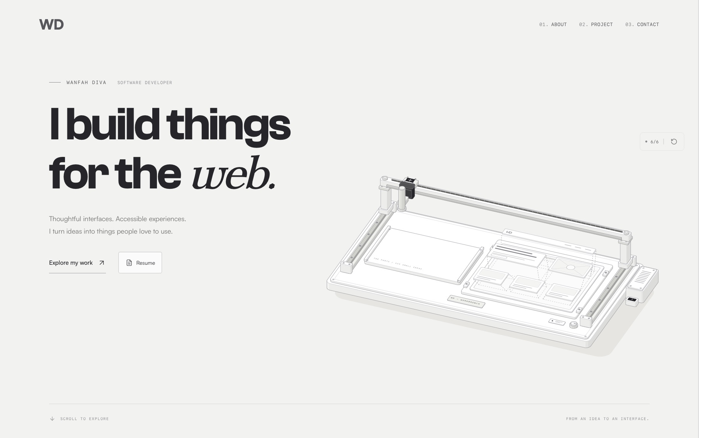
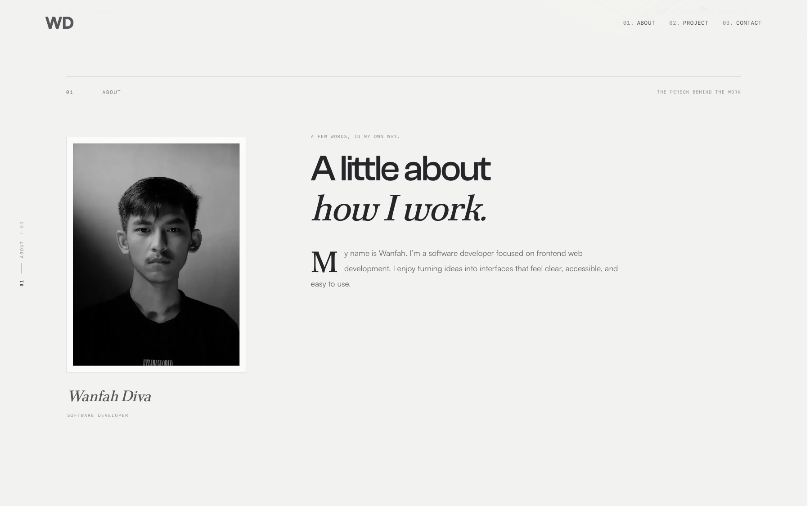
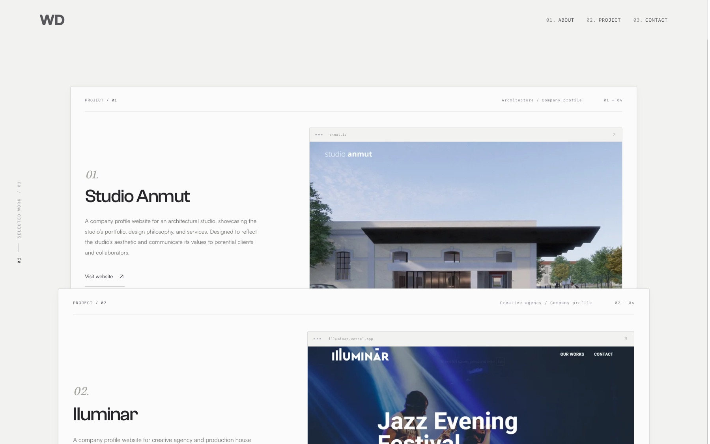
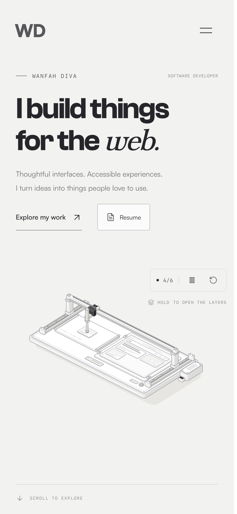
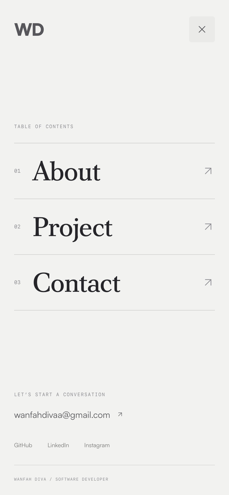

<div align="center">
  
</div>

<h1 align="center">
  wanfahdiva.com
</h1>

<p align="center">
  Personal website built with <a href="https://nextjs.org/" target="_blank">Next.js</a>, <a href="https://www.typescriptlang.org/" target="_blank">TypeScript</a>, <a href="https://tailwindcss.com/" target="_blank">Tailwind CSS</a>, <a href="https://greensock.com/gsap/" target="_blank">GSAP</a>, and <a href="https://www.framer.com/motion/" target="_blank">Framer Motion</a>. Hosted with <a href="https://www.vercel.com/" target="_blank">Vercel</a>.
</p>

<p align="center">
    
</p>



## - Preview

| Hold to open the layers                                                        | About                                                                                                                                                   |
| ------------------------------------------------------------------------------ | ------------------------------------------------------------------------------------------------------------------------------------------------------- |
|  |                                                                                                              |
| **Selected work**                                                              | **Mobile**                                                                                                                                              |
|                          |   |

## - Changelog

### 2026-11-05: Editorial revamp

A light, book-like redesign: warm paper (`#f2f2ef`), charcoal ink, monospaced metadata and serif italic accents.

**Hero: the interface workbench**

- A hand-built isometric SVG machine (94 solids, made with the MIT [Anatomy](https://skills.wheresryan.sh/anatomy) kit) picks six wireframe sheets off a stack and places them on a blank browser canvas, with pause and rebuild controls.
- On hover the whole machine turns for real (re-projected from 48° to 68°) to face its front plate. The re-projection code is a lazy chunk of about 5 KB gzip.
- Press and hold (or hold Space) to open the layers in an exploded view: sheets rise in a cascade, with dashed slots and leader lines, and the vacuum tool retracts. Release lets them settle back with a spring.
- Fixed the layering of the vacuum collar and nozzle.
- One quiet hint replaces the earlier tooltips.

**Motion**

- Drafting splash: an outline draws in, then fills, and hands off into the hero.
- The hero leaves like a book cover being turned: the copy fades and the machine drifts behind it (one scrubbed ScrollTrigger).
- Project screenshots and the About portrait are painted in once with brush strokes.
- A running folio in the left gutter (`01 — About / 03`) follows the chapter being read.
- Toolkit rows fill with ink from the left on hover and invert their type.
- The mobile menu paints its paper over the page on open and scratches it away again on close.
- Everything respects `prefers-reduced-motion`.

**Layout and content**

- About, Project (stacked cards), Contact, Footer and the mobile menu were redesigned.
- All section navigation uses `react-scroll`.
- The mobile menu is a native `<dialog>` with a focus trap, Escape to close, scroll lock and focus return. Its logo and close button sit exactly where the header's logo and menu button are.
- Project previews use a fixed 16:9 frame. The Resume button uses paper and ink styles.
- Social links appear only in the footer and the mobile menu. The duplicate sign-off in Contact was removed.

**Tooling**

- `node scripts/anatomy/build-workbench.mjs` regenerates the workbench geometry.
- `node scripts/anatomy/check-workbench.mjs` checks the pick-and-place motion.
- Motion notes live in `scripts/anatomy/MOTION.md`.

## - Installation & Set Up

1. Install Bun.sh and ensure you have Node.js version 16 or higher.

   ```sh
   powershell -c "irm bun.sh/install.ps1|iex"
   ```

2. Install dependencies

   ```sh
   bun install
   ```

3. Start the development server

   ```sh
    bun dev
   ```

4. Build for production

   ```sh
    bun run build
   ```

5. Start the production server

   ```sh
    bun start
   ```
